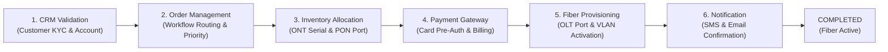
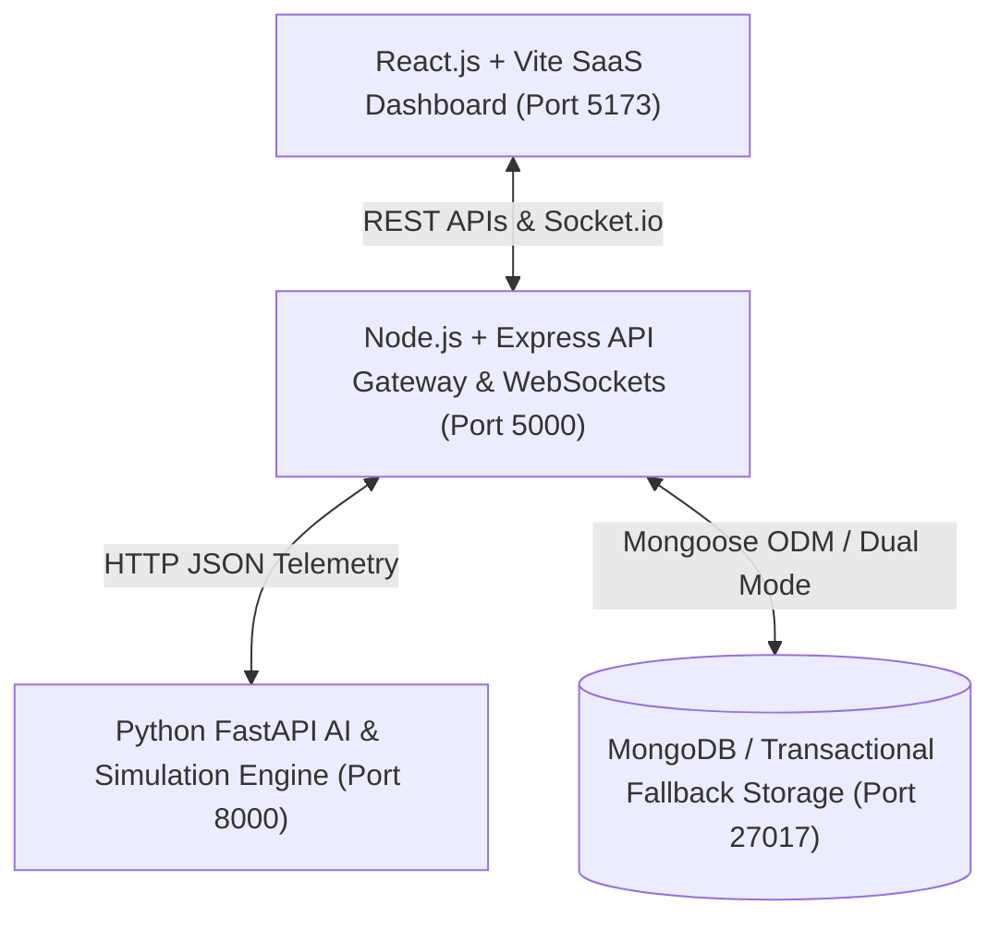

# OrderFlow Sentinel 🛡️
### Self-Healing AI for Order & API Failure Resolution with Predictive Digital Twin

> **Final-Year College Engineering Capstone Project**  
> **Domain:** Autonomous AIOps, Self-Healing Systems, Machine Learning, Telecom Order Management  
> **Environment:** Simulated Telecom Broadband Order-to-Activation Journey  
> **Test Status:** 28 / 28 Automated End-to-End Tests Passing (100%)  

---

## 📌 Table of Contents
1. [Project Overview](#-project-overview)
2. [What Makes This Innovative? (Predictive Digital Twin)](#-what-makes-this-innovative-predictive-digital-twin)
3. [The 6-Stage Telecom Broadband Order Journey](#-the-6-stage-telecom-broadband-order-journey)
4. [System Architecture](#-system-architecture)
5. [Technology Stack](#-technology-stack)
6. [Core Functional Modules](#-core-functional-modules)
7. [Installation & Setup Guide](#-installation--setup-guide)
8. [Running the Application](#-running-the-application)
9. [Running the Automated Test Suite](#-running-the-automated-test-suite)
10. [College Demonstration Script (10-Step Viva Walkthrough)](#-college-demonstration-script-10-step-viva-walkthrough)
11. [Project Documentation Directory](#-project-documentation-directory)
12. [Project Limitations & Future Scope](#-project-limitations--future-scope)

---

## 🌟 Project Overview

In telecommunication broadband fulfillment, orders frequently fail due to API timeouts, database deadlocks, billing gateway errors, and inventory stockouts. When an order breaks, human operators typically spend hours searching through log files to diagnose the root cause, causing costly **Service Level Agreement (SLA) breaches** and customer frustration.

**OrderFlow Sentinel** is an autonomous self-healing software platform that continuously monitors order pipelines, identifies failures in real time, performs evidence-based Root Cause Analysis (RCA), and automatically repairs low-risk issues using safe, idempotent retries.

### Key Capabilities
- **Real-Time Failure Detection:** Catches API response errors (HTTP 500, 502, 503, 504, 429), abnormal processing delays, and validation rejections.
- **Evidence-Based RCA:** Explains the root cause using actual chronological timeline logs without generative AI hallucinations.
- **Closed-Loop Self-Healing:** Autonomous recovery for safe errors (exponential backoff, rate limit throttling, token refresh) while requiring human approval for high-risk rejections.
- **Predictive Digital Twin:** Clones in-flight orders into a decoupled virtual sandbox, simulates multiple "What-If" scenarios concurrently, and prescribes the safest operational action to prevent SLA breaches *before* they occur.

---

## 🔮 What Makes This Innovative? (Predictive Digital Twin)

Most traditional monitoring dashboards are **reactive**—they alert engineers only *after* a customer's order has failed or breached SLA.

OrderFlow Sentinel introduces a **Predictive Digital Twin** designed as an **independent simulation module**:
1. **Actual Metric Grounding:** Rather than using arbitrary synthetic guesses, the Digital Twin uses real synthetic order metrics, observed downstream API response times, queue delays, and configured SLA targets.
2. **Strict Decoupling Guarantee:** Simulation operates purely on an in-memory virtual state clone. **It never directly modifies actual orders in the database or executes real recovery actions.**
3. **Four-Component Architecture:**
   - **Component 1 (Prediction Engine):** An unsupervised Isolation Forest flags abnormal latency spikes, while an empirically tested Gradient Boosting classifier predicts SLA breach probabilities.
   - **Component 2 (Digital Twin Simulator):** Concurrently models **Scenario A** (Continue current route), **Scenario B** (500ms backoff cooldown), and **Scenario C** (Standby backup gateway).
   - **Component 3 (Recommendation Engine):** Evaluates risk vs. duration tradeoffs and selects the safest candidate action.
   - **Component 4 (Resolution Controller):** Enforces a three-tier safety gate before any action is executed.
4. **Standardized 7-Attribute Prediction Contract:** Every prediction emitted contains:
   - Order ID
   - Risk Score (0–100)
   - Predicted SLA Breach Probability (0.0–1.0)
   - Expected Completion Time (ms)
   - Simulation Scenarios (Scenarios A, B, and C)
   - Recommended Action
   - Supporting Evidence (latencies, queue delay, anomaly score)
5. **Three-Tier Safety Policy:**
   - *Low-Risk:* Safe transient retries with idempotency keys are auto-executed.
   - *High-Risk:* Route changes require explicit operator approval.
   - *Hard Rejections:* Business validation failures (e.g. unserviceable addresses) can **never** be overridden automatically and are escalated to human review.

---

## 📡 The 6-Stage Telecom Broadband Order Journey

The system models a realistic end-to-end fiber broadband fulfillment workflow:



> **Simulation Notice:** All customer accounts, payment cards, and network serial numbers are 100% synthetic. No real telecom carrier, bank, or customer network is accessed.

---

## 🏗️ System Architecture

OrderFlow Sentinel is structured as a 4-tier microservice architecture:



- **Frontend Tier (Port 5173):** Responsive React SaaS dashboard with 7 purpose-built pages, dark navy enterprise sidebar (`#0a0f1d`), and Recharts telemetry graphs.
- **Gateway Tier (Port 5000):** Express gateway with broadband state machine orchestration, fault injection, idempotency verification, and real-time Socket.io broadcasting.
- **AI/ML Tier (Port 8000):** FastAPI engine with Scikit-Learn Isolation Forest, Gradient Boosting SLA predictor, causal RCA engine, and What-If simulator.
- **Persistence Tier (Port 27017):** MongoDB collections with transparent transactional fallback storage for offline campus evaluation.

---

## 💻 Technology Stack

| Layer | Technologies Used | Purpose |
|---|---|---|
| **Frontend** | React 18, Vite, Tailwind CSS, Lucide Icons | Responsive enterprise AI ops dashboard |
| **Data Visualizations** | Recharts (Donut, Bar, Area charts) | Pipeline health, latency trends, and risk tradeoffs |
| **Backend Gateway** | Node.js, Express.js, Socket.io | Microservice coordination, fault injection, REST APIs |
| **Artificial Intelligence** | Python 3.14, FastAPI, Uvicorn, Pydantic | High-performance asynchronous AI inference engine |
| **Machine Learning** | Scikit-Learn, Pandas, NumPy | Isolation Forest anomaly detection & Gradient Boosting SLA prediction |
| **Database** | MongoDB, Mongoose ODM | Document persistence with dual-mode offline resilience |

---

## ⚙️ Core Functional Modules (4-Component Separation)

### 1. Component 1: Real-Time Prediction Engine
- **API Response Errors:** Identifies HTTP 400, 401, 403, 429, 500, 502, 503, 504, request timeouts, and malformed JSON payloads.
- **Order Delays & Anomalies:** Compares actual processing duration against expected SLA limits ($T_{\text{SLA}} = 3500\text{ ms}$). Uses an Isolation Forest to flag slow stages and a Gradient Boosting classifier to predict breach probabilities.
- **Order Rejections:** Detects invalid customer addresses outside GPON coverage zones and hardware inventory stockouts.

### 2. Component 2: Independent Digital Twin Simulation Module
- **Decoupled Simulation Sandbox:** Runs purely as a prospective simulator in memory; **never modifies actual production orders** or triggers live recovery.
- **Real Metric Grounding:** Takes real synthetic order metrics, observed microservice response times, active queue delays, and configured SLA targets.
- **Concurrent What-If Scenarios:** Evaluates Candidate **Scenario A** (Continue current), **Scenario B** (500ms backoff cooldown), and **Scenario C** (Standby backup gateway).

### 3. Component 3: Recommendation Engine & 7-Attribute Contract
- Evaluates simulation trade-offs to prescribe the safest candidate action.
- Every prediction emitted strictly adheres to the **Standardized 7-Attribute Contract**:
  1. Order ID
  2. Risk Score (0–100)
  3. Predicted SLA Breach Probability (0.0–1.0)
  4. Expected Completion Time (ms)
  5. Simulation Scenarios (Scenarios A, B, and C)
  6. Recommended Action
  7. Supporting Evidence (latencies, queue delay, anomaly flag, preceding stages)

### 4. Component 4: Resolution Controller & Three-Tier Safety Policy
- **Low-Risk Actions (Autonomous Execution):** Transient 504 timeouts, 429 rate-limiting, and token refreshes are auto-executed using strict idempotency keys (`IDEM-...`).
- **High-Risk Actions (Operator Approval Required):** Infrastructure route changes and equipment reallocations require explicit human approval in the Resolution Centre.
- **Hard Business Rejections (Never Overridden):** Hard business validation rejections (unserviceable addresses, card declines) can **never** be overridden automatically and are escalated to human operators.
- **Circuit Breaker Ceiling:** Retries are strictly capped at 3 attempts per stage to eliminate infinite looping.

### 5. Evidence-Based Root Cause Analysis (RCA)
- Evaluates the complete chronological order timeline.
- Pinpoints the exact failing microservice and highlights previous successful stages.
- Identifies blocked downstream dependencies (e.g. provisioning timeout blocks customer notification).
- Generates transparent, human-readable explanations citing real status codes and latency without LLM hallucination.

---

## 🚀 Installation & Setup Guide

### Prerequisites
- **Node.js:** v18 or higher (tested on Node.js v24)
- **Python:** v3.10 or higher (tested on Python 3.14)
- **Git**

### Step 1: Clone or Open Project
```bash
cd "C:\Users\MAHISHA V\.gemini\antigravity\scratch\orderflow-sentinel"
```

### Step 2: Install Node.js Backend Dependencies
```bash
cd backend
npm install
```

### Step 3: Install Python AI Engine Dependencies
```bash
cd ../ai-engine
pip install fastapi uvicorn pydantic scikit-learn pandas numpy python-dotenv
```

### Step 4: Install Frontend Dependencies
```bash
cd ../frontend
npm install
```

---

## 🖥️ Running the Application

To run the complete platform, start the three microservices in separate terminal windows:

### Terminal 1: Python AI Engine (Port 8000)
```bash
cd ai-engine
python -m uvicorn app:app --host 127.0.0.1 --port 8000 --reload
```
*Health check:* Open `http://localhost:8000/health` (should display `status: "UP"` and all 6 models loaded).

### Terminal 2: Node.js Backend Gateway (Port 5000)
```bash
cd backend
node server.js
```
*Health check:* Open `http://localhost:5000/api/health` (should display `status: "UP"` and `aiEngine: "CONNECTED"`).

### Terminal 3: React Frontend (Port 5173)
```bash
cd frontend
npm run dev
```
*Web Dashboard:* Open `http://localhost:5173` in any modern web browser.

---

## 🧪 Running the Automated Test Suite

OrderFlow Sentinel includes a comprehensive automated end-to-end integration test runner:

```bash
cd backend
node test_e2e_integration.js
```

### Live Test Results:
```text
================================================================
📊 FINAL TEST RUN RESULTS SUMMARY
================================================================
Total Checks Executed : 28
Passed Checks         : 28  (100%)
Failed Checks         : 0
Overall Health Status : 🟢 ALL TESTS PASSED (100%)
================================================================
```
The test suite verifies:
1. System Health & Cross-Service Connectivity (Node + Python AI + Storage)
2. Scenario 1: API Failure (HTTP 504 $\to$ Detect $\to$ RCA $\to$ Backoff Retry $\to$ Recovery to COMPLETED)
3. Scenario 2: Order Delay (Stage Latency $\to$ Isolation Forest $\to$ SLA Breach Prediction)
4. Scenario 3: Order Rejection (Address Failure $\to$ RCA $\to$ High-Risk Safety Fence $\to$ Human Escalation)
5. Scenario 4: Predictive Digital Twin (Cloning $\to$ Multi-Scenario Simulation $\to$ Safest Action Prescription)
6. System Integrity: Idempotency enforcement, immutable audit logs, strict schemas, zero credential leaks, and CORS.

---

## 🎓 College Demonstration Script (10-Step Viva Walkthrough)

Follow this exact 10-step sequence during your project demonstration:

1. **Overview Dashboard:** Show total orders, success rates, Recharts visualizations, and live health status badges.
2. **Generate Golden Order:** Click `+ Golden Path (Success)`. Point out how all 6 stages complete in ~1.5s with HTTP 200.
3. **Monitor Order Journey:** Click `Order Details Journey`. Show the chronological stage timeline, ONT serial numbers, and GPON port metadata.
4. **Inject API Failure:** Click `Fault Injector` in header $\to$ select `PROVISIONING` $\to$ inject `504 Gateway Timeout`. Click `+ 504 Timeout Error`. Order immediately halts in red `FAILED` status.
5. **Detect Failure:** Navigate to `Failure Analysis & RCA`. Show how the AI detection engine automatically flagged `API_RESPONSE_ERROR`.
6. **Root Cause Analysis:** View the RCA explanation panel. Show that CRM, OMS, Inventory, and Payment succeeded, Provisioning timed out, and Notification was blocked.
7. **Execute Self-Healing:** Navigate to `Resolution Centre`. Show the recommendation policy (`RETRY_WITH_EXPONENTIAL_BACKOFF`, `LOW_RISK`). Click `Approve & Self-Heal`. The order recovers dynamically to green `COMPLETED`.
8. **Predictive Digital Twin:** Switch to `Predictive Digital Twin`. Point out the Gradient Boosting SLA breach probability ($88\%$), Isolation Forest anomaly flag, and model accuracy ($94.6\%$).
9. **What-If Scenario Comparison:** Review candidate Scenarios A, B, and C. Show the Tradeoff Bar Chart and point out the green `SAFEST CHOICE` badge on Scenario C (Backup Gateway, 8% residual risk).
10. **Human Escalation & Audit Trail:** Generate `+ Address Rejection`. Show that the policy blocks autonomous retry (`HIGH_RISK`) and escalates to human review. Finally, open `Audit Logs` to show the permanent, immutable audit trail.

---

## 📚 Project Documentation Directory

Detailed architectural and technical documents are available in the [`docs/`](docs/) directory:

- 🏛️ **[System Architecture](docs/SYSTEM_ARCHITECTURE.md):** Complete component breakdown, data flow, and sequence diagrams.
- 🗄️ **[Database Schema](docs/DATABASE_SCHEMA.md):** Mongoose models, entity-relationship diagrams, document fields, and indexes.
- 🧠 **[AI/ML Methodology](docs/AI_ML_METHODOLOGY.md):** Mathematical formulation of Isolation Forest, Gradient Boosting SLA classifier, and Digital Twin algorithms.
- 🔌 **[API Documentation](docs/API_DOCUMENTATION.md):** Complete REST API endpoint reference with JSON request/response payloads and WebSocket topics.
- 🎭 **[Demonstration Workflow](docs/DEMONSTRATION_WORKFLOW.md):** Step-by-step examiner presentation guide with dialogue talk tracks.
- 🧪 **[Test Cases and Results](docs/TEST_CASES_AND_RESULTS.md):** Detailed matrix of the 28 automated integration test cases.
- ⚖️ **[Limitations & Future Scope](docs/LIMITATIONS_AND_FUTURE_SCOPE.md):** Academic assessment of operational boundaries and future carrier-grade enhancements.

---

## ⚖️ Project Limitations & Future Scope

### Limitations
- **Simulated Telecom Environment:** The platform uses synthetic broadband payloads and mock network delays rather than connecting to live, physical carrier hardware (e.g. Huawei/Nokia OLT racks) to ensure zero legal or financial risk.
- **Model Training Scope:** Trained on 2,400 labeled synthetic vectors. In a live production environment, continuous online retraining would be required to handle concept drift and non-stationary seasonality.

### Future Scope
- **TM Forum Open API Alignment:** Upgrading endpoints to strict compliance with TMF622 (Product Ordering) and TMF641 (Service Ordering) standards.
- **Distributed Event Streaming:** Incorporating Apache Kafka for high-throughput distributed event replay.
- **Reinforcement Learning:** Training a Proximal Policy Optimization (PPO) agent to dynamically rebalance traffic routes based on real-time network congestion.

---

## 👨‍💻 Project Authors & Academic Attribution
- **Project Title:** OrderFlow Sentinel – Self-Healing AI for Order & API Failure Resolution
- **Academic Degree:** Final-Year Bachelor of Engineering / Technology (Computer Science / IT)
- **License:** MIT License — Open for academic demonstration and evaluation.
"# order_sentinal" 
