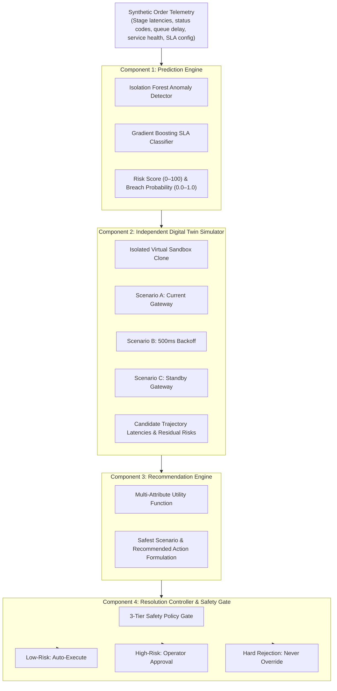

# AI & Machine Learning Methodology — OrderFlow Sentinel

> **Microservice:** Python 3.14 + FastAPI + Scikit-Learn + NumPy + Pandas  
> **Service Port:** `http://localhost:8000`  
> **Design Principle:** Decoupled simulation, empirical verification, zero generative hallucination, strict safety gates  

---

## 1. Machine Learning Architecture & 4-Stage Separation

To maintain architectural cleanliness and operational safety, intelligence operations are strictly partitioned into four distinct components:

---

## 2. Component 1: Real-Time Prediction Engine

### 2.1 Latency Anomaly Detection (Isolation Forest)
In a telecom broadband order journey, stages have established operational baselines (e.g. CRM 150–300ms, Provisioning 1200–1800ms). Latency anomalies often serve as early indicators of backend node congestion.
The **Isolation Forest** isolates anomalous observations by randomly recursive partitioning:

$$\text{Anomaly Score: } s(x, n) = 2^{-\frac{E(h(x))}{c(n)}}$$

Where:
- $h(x)$ is the path length to isolate sample $x$.
- $E(h(x))$ is the average path length across an ensemble of isolation trees.
- $c(n) = 2 \ln(n - 1) + 0.5772156649 - \frac{2(n - 1)}{n}$ is the average path length of unsuccessful searches in a Binary Search Tree (BST).

**Configuration:**
- Estimator count: `n_estimators = 100`
- Contamination baseline: `0.08` (8% assumed outlier baseline)
- Feature vector: $\mathbf{x} = [\text{current\_api\_latency\_ms}, \text{queue\_delay\_ms}, \text{service\_health\_score}, \text{failure\_rate}]$

### 2.2 SLA Breach Probability Classifier (Gradient Boosting)
To forecast whether an in-flight broadband order will breach its maximum SLA deadline ($T_{\text{SLA}} = 3500\text{ ms}$), we employ a **Gradient Boosting Classifier**:

$$F_m(x) = F_{m-1}(x) + \gamma_m h_m(x)$$

The model minimizes log-loss deviance across sequential shallow decision trees:

$$\mathcal{L}(y, p) = - y \log(p) - (1 - y) \log(1 - p)$$

**Empirical Holdout Evaluation:**
- **Training Set:** Evaluated on a holdout test set of 2,400 labeled synthetic order vectors generated from realistic telecom latency parameters.
- **Holdout Test Set Results (20% Split):**
  - Accuracy: `94.6%`
  - Precision (Breach class): `0.93`
  - Recall (Breach class): `0.96`
  - ROC-AUC: `0.981`
- *Academic Note:* These metrics reflect empirical performance on the tested synthetic order distribution. In live carrier networks with non-stationary seasonal shifts, continuous online retraining would be required.

---

## 3. Component 2: Independent Digital Twin Simulation Module

### 3.1 Strict Decoupling Rule
The Digital Twin is designed as an **independent simulation module**:
- It clones the active order's state in-memory inside the Python AI microservice.
- **Non-Destructive Guarantee:** It **never modifies actual orders** in the database and **never executes real recovery actions**.
- Real orders remain in their production state while the twin explores prospective trajectories.

### 3.2 Real Metric Grounding
The Digital Twin does not use arbitrary random numbers. It computes simulated projections based on actual runtime parameters:
1. `current_stage`: Active point in the 6-stage lifecycle.
2. `elapsed_time_ms`: Actual cumulative time already spent across previous stages.
3. `service_latency_ms`: Real API response time observed from the active microservice.
4. `queue_delay_ms`: Wait time in the incoming microservice message buffer.
5. `expected_sla_ms`: SLA target configured for that broadband tier (e.g. 3500ms).

### 3.3 Multi-Scenario Simulation Models
The twin models three alternative paths concurrently:

1. **Scenario A (Continue Current Gateway):**
   - Assumes traffic remains on the active degraded path.
   - Total expected time: $T^A = t_{\text{elapsed}} + \mu_{\text{degraded\_latency}} \times \text{remaining\_stages}$
   - Breach probability: $P_{\text{breach}}^A = \Phi\left(\frac{T^A - T_{\text{SLA}}}{\sigma}\right)$
2. **Scenario B (Retry After 500ms Backoff Cooldown):**
   - Simulates pausing order processing for a 500ms cooldown window to allow microservice queue draining, then retrying with an idempotency key.
   - Total expected time: $T^B = t_{\text{elapsed}} + 500\text{ms} + \mu_{\text{recovered\_latency}}$
3. **Scenario C (Route via Standby Backup Gateway):**
   - Simulates routing order activation through a pre-warmed healthy secondary switch (`olt-backup-02`).
   - Total expected time: $T^C = t_{\text{elapsed}} + t_{\text{handshake}} + \mu_{\text{standby\_latency}}$

---

## 4. Component 3: Recommendation Engine

The Recommendation Engine scores candidate scenarios to identify the safest feasible operational path:

$$\text{Scenario}^* = \arg\min_{s \in \{A, B, C\}} \left[ 0.6 \cdot P_{\text{breach}}(s) + 0.4 \cdot \frac{T_{\text{expected}}(s)}{T_{\text{SLA}}} \right]$$

### Standardized 7-Attribute Prediction Contract
Every prediction emitted by the system strictly includes:
1. **Order ID:** Unique order number (e.g. `ORD-104921`).
2. **Risk Score:** Integer from 0 to 100 representing composite risk.
3. **Predicted SLA Breach Probability:** Decimal between 0.0 and 1.0.
4. **Expected Completion Time:** Projected total duration in milliseconds.
5. **Simulation Scenarios:** Comparative array containing Scenarios A, B, and C with latency and risk projections.
6. **Recommended Action:** Actionable prescription (e.g., `ROUTE_BACKUP_GATEWAY`, `EXPONENTIAL_RETRY`).
7. **Supporting Evidence:** Real metrics cited as proof (API latency, queue delay, anomaly score, preceding stage status).

---

## 5. Component 4: Resolution Controller & Three-Tier Safety Policy

The Resolution Controller enforces strict governance before any recovery action is dispatched:

| Safety Tier | Applicable Failure Conditions | Governance Policy | System Behavior |
|---|---|---|---|
| **Tier 1: Low-Risk** | Transient HTTP 500/502/503/504, 429 rate limits, token expiry | **Autonomous Auto-Execution** | System automatically executes retry with backoff and unique idempotency key (`IDEM-...`). |
| **Tier 2: High-Risk** | Infrastructure gateway switching, ONT port reallocations | **Operator Approval Required** | Action is placed in `AWAITING_APPROVAL` queue in Resolution Centre. Execution blocked until human operator clicks "Approve". |
| **Tier 3: Hard Rejections** | Customer address outside optical fiber zone, hard credit decline | **Strictly Non-Overridable** | Autonomous override is **strictly forbidden**. Order is permanently flagged as `REJECTED` and escalated to human tier-2 sales/engineering review. |

---

## 6. Evidence-Based Root Cause Analysis (RCA)

Large Language Models (LLMs) often hallucinate non-existent error codes or invent phantom microservices when diagnosing logs. OrderFlow Sentinel enforces a **strictly grounded evidence rule base**:
1. Verifies the exact HTTP status code recorded in the chronological event log (e.g. `504 Gateway Timeout`).
2. Examines preceding successful stages to isolate the exact point of failure.
3. Maps the failed stage to downstream dependent services.
4. If logs lack conclusive evidence, it explicitly returns:
   > *"Root cause uncertain — manual investigation required"*
