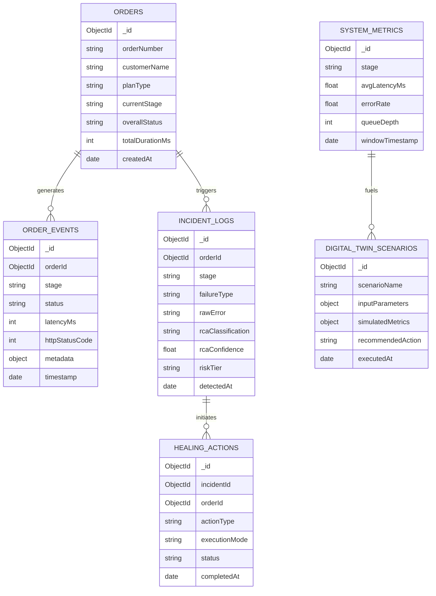

# Database Design & Schemas 🗄️
### OrderFlow Sentinel – MongoDB Architecture

This document defines the schema design, field descriptions, indexing strategy, and sample documents for all MongoDB collections in **OrderFlow Sentinel**.

---

## 1. Why MongoDB for OrderFlow Sentinel?

1. **Flexible Telemetry Payloads:** Different telecom stages (CRM, Inventory, Provisioning) produce distinct metadata (e.g., ONT serial numbers for inventory vs. PON port IDs for provisioning). MongoDB's document model handles heterogeneous stage payloads without rigid SQL schema migrations.
2. **High-Speed Ingestion:** Telemetry and event audit trails require rapid, non-blocking inserts as orders transit the 6-stage simulated pipeline.
3. **Time-Series & Query Friendly:** Indexing by `timestamp`, `orderId`, and `status` allows fast retrieval for live UI dashboards, Recharts analytics, and Python ML feature extraction.

---

## 2. Collection Overview & Relationships



---

## 3. Detailed Collection Schemas

### 1. `orders` Collection
Maintains the high-level state, customer details, broadband package, and timing metrics for every order.

#### Mongoose Schema Definition
```javascript
const OrderSchema = new mongoose.Schema({
  orderNumber: { type: String, required: true, unique: true, index: true },
  customer: {
    name: { type: String, required: true },
    email: { type: String, required: true },
    phone: { type: String, required: true },
    installationAddress: {
      street: String,
      city: String,
      postalCode: String,
      serviceZone: String // e.g., "Zone-North-4"
    }
  },
  plan: {
    planId: { type: String, required: true },
    planName: { type: String, required: true }, // e.g., "Fiber Max 500 Mbps"
    speedMbps: { type: Number, required: true },
    monthlyFee: { type: Number, required: true }
  },
  currentStage: {
    type: String,
    enum: ['CRM', 'ORDER_MANAGEMENT', 'INVENTORY', 'PAYMENT', 'PROVISIONING', 'NOTIFICATION', 'COMPLETED'],
    default: 'CRM',
    index: true
  },
  overallStatus: {
    type: String,
    enum: ['PENDING', 'PROCESSING', 'DELAYED', 'FAILED', 'HEALING', 'COMPLETED', 'REJECTED'],
    default: 'PENDING',
    index: true
  },
  stageTimestamps: {
    crmStartedAt: Date,
    crmCompletedAt: Date,
    omsStartedAt: Date,
    omsCompletedAt: Date,
    inventoryStartedAt: Date,
    inventoryCompletedAt: Date,
    paymentStartedAt: Date,
    paymentCompletedAt: Date,
    provisioningStartedAt: Date,
    provisioningCompletedAt: Date,
    notificationStartedAt: Date,
    notificationCompletedAt: Date
  },
  totalDurationMs: { type: Number, default: 0 },
  slaBreachPredicted: { type: Boolean, default: false },
  slaBreachProbability: { type: Number, default: 0.0 },
  failureCount: { type: Number, default: 0 },
  isAutoHealed: { type: Boolean, default: false }
}, { timestamps: true });
```

---

### 2. `order_events` Collection
Granular event audit trail logging every step an order takes across the 6 pipeline stages.

#### Mongoose Schema Definition
```javascript
const OrderEventSchema = new mongoose.Schema({
  orderId: { type: mongoose.Schema.Types.ObjectId, ref: 'Order', required: true, index: true },
  orderNumber: { type: String, required: true, index: true },
  stage: {
    type: String,
    enum: ['CRM', 'ORDER_MANAGEMENT', 'INVENTORY', 'PAYMENT', 'PROVISIONING', 'NOTIFICATION'],
    required: true
  },
  eventType: {
    type: String,
    enum: ['STAGE_STARTED', 'STAGE_SUCCESS', 'STAGE_TIMEOUT', 'STAGE_ERROR', 'STAGE_RETRY'],
    required: true
  },
  httpStatusCode: { type: Number, default: 200 },
  latencyMs: { type: Number, required: true },
  metadata: { type: mongoose.Schema.Types.Mixed }, // stage-specific payload (ONT serial, IP, auth tokens)
  errorMessage: { type: String, default: null },
  timestamp: { type: Date, default: Date.now, index: true }
});
```

---

### 3. `incident_logs` Collection
Records all detected failures, API error codes, AI-driven Root Cause Analysis (RCA) outcomes, and associated risk classifications.

#### Mongoose Schema Definition
```javascript
const IncidentLogSchema = new mongoose.Schema({
  incidentId: { type: String, required: true, unique: true, index: true },
  orderId: { type: mongoose.Schema.Types.ObjectId, ref: 'Order', required: true, index: true },
  orderNumber: { type: String, required: true },
  stage: { type: String, required: true },
  failureCategory: {
    type: String,
    enum: ['API_RESPONSE_ERROR', 'ORDER_DELAY', 'ORDER_REJECTION'],
    required: true,
    index: true
  },
  rawError: {
    statusCode: Number,
    message: String,
    stackSnippet: String
  },
  rcaDetails: {
    classifiedRootCause: { type: String, required: true }, // e.g., "PAYMENT_GATEWAY_TIMEOUT"
    confidenceScore: { type: Number, required: true }, // e.g., 0.94
    modelUsed: { type: String, default: 'RandomForestClassifier_v1' },
    contributingFeatures: [String] // e.g., ["latency_ms > 3500", "http_status == 504"]
  },
  riskTier: {
    type: String,
    enum: ['LOW', 'MEDIUM', 'HIGH'],
    required: true
  },
  resolutionStatus: {
    type: String,
    enum: ['OPEN', 'IN_REMEDIATION', 'AUTO_RESOLVED', 'ESCALATED', 'FAILED_REMEDIATION'],
    default: 'OPEN',
    index: true
  },
  detectedAt: { type: Date, default: Date.now, index: true }
}, { timestamps: true });
```

---

### 4. `healing_actions` Collection
Maintains an audit trail of self-healing remediation routines executed by the system or human operators.

#### Mongoose Schema Definition
```javascript
const HealingActionSchema = new mongoose.Schema({
  actionId: { type: String, required: true, unique: true },
  incidentId: { type: mongoose.Schema.Types.ObjectId, ref: 'IncidentLog', required: true, index: true },
  orderId: { type: mongoose.Schema.Types.ObjectId, ref: 'Order', required: true },
  orderNumber: { type: String, required: true },
  actionType: {
    type: String,
    enum: [
      'EXPONENTIAL_RETRY',
      'INVENTORY_WAREHOUSE_FAILOVER',
      'NOTIFICATION_CHANNEL_FALLBACK',
      'CIRCUIT_BREAKER_RESET',
      'MANUAL_ENGINEER_DISPATCH'
    ],
    required: true
  },
  executionMode: {
    type: String,
    enum: ['AUTOMATIC_ZERO_TOUCH', 'HUMAN_APPROVED'],
    required: true
  },
  parameters: {
    attemptNumber: { type: Number, default: 1 },
    targetAlternative: String, // e.g., "Warehouse-East-Backup"
    backoffDelayMs: Number
  },
  executionResult: {
    success: { type: Boolean, required: true },
    responseSummary: String,
    executionDurationMs: Number
  },
  performedAt: { type: Date, default: Date.now }
});
```

---

### 5. `digital_twin_scenarios` Collection
Stores historical inputs, simulated outcomes, and prescriptive AI recommendations generated by the Predictive Digital Twin.

#### Mongoose Schema Definition
```javascript
const DigitalTwinScenarioSchema = new mongoose.Schema({
  scenarioId: { type: String, required: true, unique: true },
  scenarioName: { type: String, required: true }, // e.g., "Simulated 50% Surge in Orders"
  inputs: {
    orderArrivalMultiplier: { type: Number, default: 1.0 }, // e.g., 1.5
    injectedStageDelayMs: {
      stage: String,
      addedDelay: Number
    },
    simulatedDurationMinutes: { type: Number, default: 60 }
  },
  baselineMetrics: {
    totalOrdersSimulated: Number,
    baselineSlaBreachRate: Number, // e.g., 0.04 (4%)
    avgCycleTimeSeconds: Number
  },
  simulatedMetrics: {
    predictedSlaBreachRate: Number, // e.g., 0.28 (28%)
    predictedBottleneckStage: String, // e.g., "PROVISIONING"
    projectedQueueSpike: Number
  },
  prescriptiveRecommendations: [
    {
      action: String, // e.g., "Scale Provisioning Worker concurrency from 4 to 8"
      expectedSlaRiskReduction: Number, // e.g., 0.21 (reduces breach to 7%)
      safetyRank: Number // 1 (Safest), 2, 3
    }
  ],
  executedAt: { type: Date, default: Date.now }
});
```

---

### 6. `system_metrics` Collection
Holds 1-minute to 15-minute rolling averages of stage throughput, queue depths, and latency, feeding the Digital Twin model.

#### Mongoose Schema Definition
```javascript
const SystemMetricSchema = new mongoose.Schema({
  timestamp: { type: Date, default: Date.now, index: true },
  windowDurationSec: { type: Number, default: 60 },
  stageMetrics: [
    {
      stage: { type: String, required: true },
      avgLatencyMs: Number,
      p95LatencyMs: Number,
      throughputOrdersPerMin: Number,
      errorCount: Number,
      activeQueueSize: Number
    }
  ]
});
```

---

## 4. Indexing Strategy for High Performance

To ensure real-time responsiveness on the React frontend and fast training data extraction for Python:

| Collection | Indexed Fields | Purpose |
| :--- | :--- | :--- |
| `orders` | `{ orderNumber: 1 }` (Unique) | Rapid lookup of order status |
| `orders` | `{ currentStage: 1, overallStatus: 1 }` | Fast pipeline stage filtering on dashboard |
| `order_events` | `{ orderId: 1, timestamp: -1 }` | Fast timeline generation for individual orders |
| `incident_logs`| `{ resolutionStatus: 1, detectedAt: -1 }` | Fast retrieval of active failures needing attention |
| `system_metrics`| `{ timestamp: -1 }` | Rolling metrics extraction for the Digital Twin |
