# Database Schema Documentation — OrderFlow Sentinel

> **Storage Technology:** MongoDB (Document-Oriented NoSQL)  
> **Object Data Modeling (ODM):** Mongoose (Node.js)  
> **Resilience Mode:** Dual-Mode Transactional Fallback Storage  

---

## 1. Entity-Relationship Model

```mermaid
erDiagram
    ORDER ||--o{ ORDER_EVENT : generates
    ORDER ||--o{ INCIDENT_LOG : attributes
    ORDER ||--o{ DIGITAL_TWIN_SCENARIO : simulates
    ORDER ||--o{ HEALING_ACTION_LOG : remediates

    ORDER {
        ObjectId _id PK
        string orderNumber UK "Indexed"
        string correlationId UK "Indexed"
        object customer "Name, Email, Synthetic Address"
        object product "Plan, Speed, Monthly Price"
        string currentStage "CRM, OMS, INVENTORY, PAYMENT, PROVISIONING, NOTIFICATION, COMPLETED"
        string overallStatus "IN_FLIGHT, COMPLETED, FAILED, DELAYED, REJECTED, STUCK"
        number expectedSlaMs "e.g. 3500ms"
        number actualProcessingTimeMs
        number failureCount
        string scenario "SUCCESS, API_ERROR, DELAY, REJECTION, STUCK"
        date createdAt
        date updatedAt
    }

    ORDER_EVENT {
        ObjectId _id PK
        ObjectId orderId FK
        string orderNumber "Indexed"
        string correlationId "Indexed"
        string stage "Stage where event occurred"
        string fromStage
        string toStage
        string eventType "STAGE_STARTED, STAGE_COMPLETED, STAGE_FAILED, STAGE_DELAYED, STAGE_REJECTED"
        number httpStatusCode "200, 422, 500, 504"
        number latencyMs
        string errorMessage
        object metadata "ONT serial, PON port, IP subnet, Payment ref"
        date timestamp
    }

    INCIDENT_LOG {
        ObjectId _id PK
        string incidentId UK "Indexed (e.g. INC-104921)"
        ObjectId orderId FK
        string orderNumber "Indexed"
        string correlationId
        string failureCategory "API_RESPONSE_ERROR, ORDER_DELAY, ORDER_REJECTION"
        string failureReason
        string affectedService
        string severity "LOW, MEDIUM, HIGH, CRITICAL"
        number httpStatusCode
        string resolutionStatus "PENDING, IN_PROGRESS, AUTO_RESOLVED, ESCALATED"
        object rcaDetails "Root cause breakdown & evidence"
        object supportingEvidence "HTTP status, latency, raw error log"
        date detectionTimestamp
    }

    DIGITAL_TWIN_SCENARIO {
        ObjectId _id PK
        string predictionId UK "Indexed (e.g. PRED-88219)"
        string orderNumber "Indexed"
        string correlationId
        number riskScore "0 to 100"
        string currentStage
        number elapsedTimeMs
        number expectedSlaMs
        number expectedCompletionTimeMs
        number baselineBreachRisk
        number predictedSlaBreachProbability "0.0 - 1.0"
        boolean isServiceAnomalous
        object safestScenario "Safest scenario & tradeoff details"
        array simulationScenarios "Scenarios A, B, and C"
        string recommendedAction "e.g. ROUTE_BACKUP_GATEWAY"
        string prescriptiveRecommendation
        object supportingEvidence "Observed latency, queue delay, anomaly score"
        date analysisTimestamp
    }

    HEALING_ACTION_LOG {
        ObjectId _id PK
        string actionId UK "Indexed (e.g. ACT-88219)"
        string orderNumber "Indexed"
        string correlationId
        string stage
        string actionType "EXPONENTIAL_RETRY, RATE_LIMIT_THROTTLE, TOKEN_REFRESH, ESCALATE_HUMAN_OPERATOR"
        string recommendedAction
        string riskTier "LOW_RISK, MEDIUM_RISK, HIGH_RISK"
        boolean requiresHumanApproval
        string status "RECOMMENDED, APPROVED, REJECTED, EXECUTED, COMPLETED, FAILED"
        string idempotencyKey UK "Indexed"
        string decisionReason
        string initiatedBy "AUTONOMOUS_SENTINEL_AI, OPERATOR_DISPATCH"
        object parameters "Attempt number, backoff delay, corrections"
        object result "Recovered status, duration, verified HTTP code"
        date createdAt
        date executedAt
    }
```



---

## 2. Detailed Schema Definitions

### 2.1 Orders Collection (`orders`)
Stores the primary state machine document for every synthetic broadband order.

```javascript
const OrderSchema = new mongoose.Schema({
  orderNumber: { type: String, required: true, unique: true, index: true },
  correlationId: { type: String, required: true, unique: true, index: true },
  customer: {
    name: { type: String, required: true },
    email: { type: String, required: true },
    phone: { type: String, required: true },
    address: { type: String, required: true },
    customerRef: { type: String, required: true }
  },
  product: {
    planName: { type: String, required: true },
    speedMbps: { type: Number, required: true },
    priceMonthly: { type: Number, required: true },
    technology: { type: String, default: 'GPON_FIBER' }
  },
  currentStage: {
    type: String,
    enum: ['CRM', 'OMS', 'INVENTORY', 'PAYMENT', 'PROVISIONING', 'NOTIFICATION', 'COMPLETED'],
    default: 'CRM',
    index: true
  },
  overallStatus: {
    type: String,
    enum: ['IN_FLIGHT', 'COMPLETED', 'FAILED', 'DELAYED', 'REJECTED', 'STUCK'],
    default: 'IN_FLIGHT',
    index: true
  },
  scenario: {
    type: String,
    enum: ['SUCCESS', 'API_ERROR', 'DELAY', 'REJECTION', 'STUCK', 'RANDOM'],
    default: 'SUCCESS'
  },
  expectedSlaMs: { type: Number, default: 3500 },
  actualProcessingTimeMs: { type: Number, default: 0 },
  failureCount: { type: Number, default: 0 }
}, { timestamps: true });
```

---

### 2.2 Order Events Collection (`order_events`)
Chronological audit record of every stage progression, transition, and fault injection.

```javascript
const OrderEventSchema = new mongoose.Schema({
  orderId: { type: mongoose.Schema.Types.ObjectId, ref: 'Order', required: true },
  orderNumber: { type: String, required: true, index: true },
  correlationId: { type: String, required: true, index: true },
  stage: { type: String, required: true },
  fromStage: { type: String },
  toStage: { type: String },
  eventType: {
    type: String,
    enum: ['STAGE_STARTED', 'STAGE_COMPLETED', 'STAGE_FAILED', 'STAGE_DELAYED', 'STAGE_REJECTED', 'STAGE_STUCK'],
    required: true
  },
  httpStatusCode: { type: Number, default: 200 },
  latencyMs: { type: Number, default: 0 },
  errorMessage: { type: String, default: null },
  metadata: { type: mongoose.Schema.Types.Mixed, default: {} },
  timestamp: { type: Date, default: Date.now, index: true }
});
```

---

### 2.3 Incidents Collection (`incident_logs`)
Captures all failures diagnosed by rule matching or AI models.

```javascript
const IncidentLogSchema = new mongoose.Schema({
  incidentId: { type: String, required: true, unique: true, index: true },
  orderId: { type: mongoose.Schema.Types.ObjectId, ref: 'Order' },
  orderNumber: { type: String, required: true, index: true },
  correlationId: { type: String, required: true },
  failureCategory: {
    type: String,
    enum: ['API_RESPONSE_ERROR', 'ORDER_DELAY', 'ORDER_REJECTION'],
    required: true,
    index: true
  },
  failureReason: { type: String, required: true },
  affectedService: { type: String, required: true },
  failedStage: { type: String },
  severity: { type: String, enum: ['LOW', 'MEDIUM', 'HIGH', 'CRITICAL'], default: 'HIGH' },
  httpStatusCode: { type: Number },
  resolutionStatus: {
    type: String,
    enum: ['PENDING', 'AWAITING_APPROVAL', 'IN_PROGRESS', 'AUTO_RESOLVED', 'RESOLVED', 'ESCALATED', 'REJECTED'],
    default: 'PENDING',
    index: true
  },
  rcaDetails: { type: mongoose.Schema.Types.Mixed, default: null },
  supportingEvidence: { type: mongoose.Schema.Types.Mixed, default: {} },
  detectionTimestamp: { type: Date, default: Date.now }
}, { timestamps: true });
```

---

### 2.4 Digital Twin Scenarios Collection (`digital_twin_scenarios`)
Stores prospective simulation outcomes without mutating real production data.

```javascript
const DigitalTwinScenarioSchema = new mongoose.Schema({
  predictionId: { type: String, required: true, unique: true, index: true },
  orderNumber: { type: String, required: true, index: true },
  correlationId: { type: String, required: true },
  riskScore: { type: Number, default: 0 },
  currentStage: { type: String, required: true },
  elapsedTimeMs: { type: Number, required: true },
  expectedSlaMs: { type: Number, required: true },
  expectedCompletionTimeMs: { type: Number, default: 0 },
  baselineBreachRisk: { type: Number, required: true },
  mlModelBreachProbability: { type: Number, required: true },
  predictedSlaBreachProbability: { type: Number, default: 0 },
  modelAccuracy: { type: String, default: 'Empirically evaluated on holdout test set' },
  isServiceAnomalous: { type: Boolean, default: false },
  safestScenario: { type: mongoose.Schema.Types.Mixed, required: true },
  simulationScenarios: [{
    scenarioKey: { type: String, required: true },
    name: { type: String, required: true },
    description: { type: String },
    estimatedProcessingTimeMs: { type: Number },
    predictedSlaBreachRisk: { type: Number },
    expectedTotalDurationMs: { type: Number },
    recommendedAction: { type: String },
    isSafest: { type: Boolean, default: false }
  }],
  recommendedAction: { type: String, required: true },
  prescriptiveRecommendation: { type: String, required: true },
  supportingEvidence: { type: mongoose.Schema.Types.Mixed, default: {} },
  analysisTimestamp: { type: Date, default: Date.now }
}, { timestamps: true });
```

---

### 2.5 Remediation Audit Trail (`healing_action_logs`)
Maintains an immutable record of autonomous self-healing and human operations.

```javascript
const HealingActionLogSchema = new mongoose.Schema({
  actionId: { type: String, required: true, unique: true, index: true },
  orderNumber: { type: String, required: true, index: true },
  correlationId: { type: String, required: true },
  stage: { type: String, required: true },
  actionType: { type: String, required: true },
  recommendedAction: { type: String, required: true },
  riskTier: { type: String, enum: ['LOW_RISK', 'MEDIUM_RISK', 'HIGH_RISK'], required: true },
  requiresHumanApproval: { type: Boolean, default: false },
  status: {
    type: String,
    enum: ['RECOMMENDED', 'APPROVED', 'REJECTED', 'EXECUTING', 'COMPLETED', 'FAILED'],
    default: 'RECOMMENDED'
  },
  idempotencyKey: { type: String, required: true, unique: true, index: true },
  decisionReason: { type: String, required: true },
  initiatedBy: { type: String, default: 'AUTONOMOUS_SENTINEL_AI' },
  parameters: { type: mongoose.Schema.Types.Mixed, default: {} },
  result: { type: mongoose.Schema.Types.Mixed, default: {} }
}, { timestamps: true });
```

---

## 3. Local MongoDB Community Server Verification Results

### 3.1 Connection Configuration
- **Connection URI:** `mongodb://127.0.0.1:27017/orderflow_sentinel`
- **Environment File:** `backend/.env` (Configured and secured in `.gitignore`)
- **Active Connection Mode:** `PERSISTENT_MONGODB`
- **Security Guardrail:** Credentials and full URI with secrets are sanitized from console logs.

### 3.2 Verified Database Collections
All 5 canonical collections are created, indexed, and actively persisting documents:
1. `orders`: High-fidelity broadband order state, stage timestamps, and SLA metrics.
2. `orderevents`: Chronological stage transition telemetry and latency records.
3. `incidentlogs`: Failure classifications, root cause analyses, and severity tiers.
4. `healingactions`: Remediation actions, idempotency keys, operator approval logs, and execution summaries.
5. `digitaltwinscenarios`: Virtual What-If simulation outputs, scenario comparisons (A, B, C), and prescriptive guidance.

### 3.3 Backend Restart Survivability Verification
- **Test Executed:** `backend/test_mongodb_persistence.js`
- **Step 1:** Created test order `ORD-PERSTEST-6850` with associated event, incident, healing action, and digital twin prediction.
- **Step 2:** Completely terminated the backend process daemon (Task ID killed).
- **Step 3:** Launched fresh Node.js backend instance on port 5000.
- **Step 4:** Queried MongoDB directly and via REST API `GET /api/orders/ORD-PERSTEST-6850`.
- **Verdict:** **PASS (100% Data Survivability)** — All documents, stage histories, and audit records remained intact.

### 3.4 Health Check API Status
`GET /api/health` accurately reports live storage mode:
```json
{
  "status": "UP",
  "storageMode": "PERSISTENT_MONGODB",
  "dependencies": {
    "database": {
      "name": "MongoDB",
      "status": "CONNECTED",
      "isReady": true,
      "mode": "PERSISTENT_MONGODB",
      "databaseName": "orderflow_sentinel"
    }
  }
}
```
*Note: If the MongoDB service is stopped, `storageMode` transparently reports `IN_MEMORY_FALLBACK` with an explicit data-loss warning.*
