# College Project Demonstration Script & Workflow — OrderFlow Sentinel

> **Target Audience:** College Project Viva Examiners, Academic Review Committee, Software Industry Panelists  
> **Duration:** 10 – 15 Minutes  
> **Presentation Tone:** Clear, beginner-friendly, professional, grounded strictly in implemented features  

---

## Quick Demonstration Checklist Before You Begin

1. **Python AI Engine running:** `http://localhost:8000/health` returns `status: UP`.
2. **Node.js Gateway running:** `http://localhost:5000/api/health` returns `status: UP` and `aiEngine: CONNECTED`.
3. **React Frontend running:** `http://localhost:5173` opened in your web browser.
4. **Sidebar Navigation Visible:** Ensure full-screen browser display for clean responsive presentation.

---

## 10-Step Complete Live Demonstration Flow

```mermaid
flowchart LR
    S1["1. Generate Golden Order"] --> S2["2. Monitor Order Journey"]
    S2 --> S3["3. Inject 504 Failure"]
    S3 --> S4["4. Failure Detection"]
    S4 --> S5["5. Root Cause Analysis"]
    S5 --> S6["6. Auto Recovery"]
    S6 --> S7["7. Digital Twin Sandbox"]
    S7 --> S8["8. What-If Comparison"]
    S8 --> S9["9. Human Escalation"]
    S9 --> S10["10. Audit Trail"]
```

---

### Step 1: Generating a Normal Order (The "Golden Path")
- **Action in UI:** On the **Overview Dashboard**, click the **"+ Golden Path (Success)"** button or the top **"Simulate Order"** button and pick **"1. Golden Path (Success)"**.
- **What Happens on Screen:**
  - An order (e.g. `ORD-104921`) is dispatched into the 6-stage simulated telecom pipeline.
  - The **Total Orders** and **Successful Orders** metric counters increment in real time.
  - The order status donut chart updates automatically via Socket.io.
- **Examiner Talk Track:**
  > *"Examiners, we begin by dispatching a normal broadband order. Our backend coordinates the order across CRM customer validation, Order Management (ORDER_MANAGEMENT) orchestration, inventory port allocation, payment pre-authorization, optical fiber provisioning, and customer notification. Within 1.5 seconds, all stages return HTTP 200, and the order completes successfully."*

---

### Step 2: Monitoring the Live Order Journey
- **Action in UI:** Click **"Order Details Journey"** in the sidebar (or click the **"Journey"** button next to the order in the monitoring table).
- **What Happens on Screen:**
  - A chronological visual progression of all 6 stages is displayed with green success badges.
  - For each stage, examiners can see:
    - Executing microservice name (e.g., `olt-provisioner`, `billing-adapter`).
    - HTTP response code (`HTTP 200`).
    - Exact duration (e.g., `180 ms`).
    - Domain metadata (e.g., ONT serial `ONT-HW-8271`, PON port `PON-04`, allocated IP subnet).
- **Examiner Talk Track:**
  > *"Here, the Order Details page shows end-to-end stage telemetry. Notice that every stage records independent latency, status codes, and synthetic telecom metadata like optical network terminal serial numbers and allocated GPON ports. This full timeline is what our AI engine evaluates for health."*

---

### Step 3: Injecting an API Failure (HTTP 504 Gateway Timeout)
- **Action in UI:** On the **Overview Dashboard**, click the **"+ 504 Timeout Error"** button (or click **"Simulate Order"** in the top bar and select **"2. API Timeout / 504 Failure"**).
- **What Happens on Screen:**
  - The pipeline progresses through CRM, ORDER_MANAGEMENT, and INVENTORY successfully.
  - At the **PAYMENT** stage, the vendor payment gateway times out with an injected `HTTP 504 Gateway Timeout`.
  - The order terminates immediately with a bright red **`FAILED`** badge. Downstream stages (`PROVISIONING`, `NOTIFICATION`) are prevented from running.
- **Examiner Talk Track:**
  > *"Now, we simulate a realistic transient failure. Upstream payment authorization gateways occasionally experience network timeouts under traffic bursts. The system halts the order at the PAYMENT stage, skips subsequent downstream provisioning, and records an HTTP 504 Gateway Timeout event in the database."*

---

### Step 4: Real-Time Failure Detection
- **Action in UI:** Navigate to the **"Failure Analysis & RCA"** page (or click **"Run Failure Detection"** on the Order Details view).
- **What Happens on Screen:**
  - The incident appears immediately in the incident queue.
  - Category is clearly attributed: `API_RESPONSE_ERROR`.
  - Severity is classified as `HIGH`.
- **Examiner Talk Track:**
  > *"Instead of relying on human operators to notice broken orders in logs, our Failure Detection Engine instantly inspects timeline events and attributes the incident to API Response Errors without manual intervention."*

---

### Step 5: AI-Driven Root Cause Analysis (RCA)
- **Action in UI:** Select the incident on the **Failure Analysis & RCA** page and view the deep-dive panel on the right.
- **What Happens on Screen:**
  - The **Root Cause Explanation** card renders:
    > *"The PAYMENT service did not respond within the configured timeout threshold (2000ms). Previous 3 stages completed successfully. Gateway returned HTTP 504 Gateway Timeout."*
  - Shows that stages CRM, ORDER_MANAGEMENT, and INVENTORY succeeded.
  - Shows that downstream stages **PROVISIONING** and **NOTIFICATION** are blocked.
  - Raw supporting log evidence is displayed in the terminal box.
- **Examiner Talk Track:**
  > *"Our RCA Engine provides evidence-based reasoning. Notice it does not invent fake errors or hallucinate logs. It explicitly cites the preceding successful stages, confirms that the fault originated at PAYMENT, and flags that downstream Provisioning and Notification are blocked."*

---

### Step 6: Automatic Self-Healing & Recovery
- **Action in UI:** Click the **"Execute Healing"** button (or navigate to **Resolution Centre**), review the recommendation (`RETRY_WITH_EXPONENTIAL_BACKOFF`), and click **"Approve & Self-Heal"** (or click **"Direct Retry"**).
- **What Happens on Screen:**
  - The system executes an idempotent retry with a 500ms backoff cooldown.
  - The PAYMENT stage retries and completes with HTTP 200, followed by subsequent PROVISIONING and NOTIFICATION stages.
  - The order status dynamically flips to green **`COMPLETED`**.
  - A green success confirmation toast appears: *"Resolution successfully executed! Order self-healed."*
- **Examiner Talk Track:**
  > *"For low-risk transient errors like 504 timeouts, our Self-Healing Engine automatically calculates an exponential backoff retry. It injects an RFC-compliant idempotency key so we never double-provision or double-charge. Within milliseconds, the order heals and completes."*

---

### Step 7: Predictive Digital Twin Activation
- **Action in UI:** Navigate to the **"Predictive Digital Twin"** tab in the sidebar and select an in-flight or delayed order from the dropdown.
- **What Happens on Screen:**
  - Displays ML Model SLA Breach Probability (e.g. `88%`).
  - Displays Scikit-Learn **Isolation Forest** Anomaly Flag (`UNUSUAL LATENCY SPIKE`).
  - Displays empirical model accuracy from holdout test evaluation (`94.6%`).
  - An elapsed time vs SLA progress bar shows how close the order is to breaching its limit.
  - The standardized **7-Attribute Prediction Contract** is displayed: Order ID, Risk Score, Predicted Breach Probability, Expected Completion Time, Simulation Scenarios, Recommended Action, and Supporting Evidence.
- **Examiner Talk Track:**
  > *"This is our innovative feature: the Predictive Digital Twin. Rather than waiting for a failure to happen, the Digital Twin operates as an independent simulation module. It takes real synthetic runtime parameters—observed API latencies, queue wait times, and SLA thresholds—and clones the order into an in-memory virtual sandbox. Using an Isolation Forest and Gradient Boosting classifier, it estimates an 88% probability of an SLA breach before the order actually terminates."*

---

### Step 8: What-If Multi-Scenario Simulation & Tradeoff
- **Action in UI:** Scroll down to the **What-If Multi-Scenario Simulation Comparison** cards and the Recharts Tradeoff Bar Chart.
- **What Happens on Screen:**
  - **Scenario A (Continue Current Gateway):** Est. Total 3850ms | 88% SLA Breach Risk.
  - **Scenario B (500ms Backoff Retry):** Est. Total 2850ms | 45% SLA Breach Risk.
  - **Scenario C (Route via Standby Backup Gateway):** Est. Total 1870ms | 8% SLA Breach Risk with a glowing green **`SAFEST CHOICE`** badge.
  - The bar chart visually contrasts projected duration vs. residual risk.
- **Examiner Talk Track:**
  > *"Notice the architectural decoupling here: simulation is completely separated from execution. The Digital Twin tests three alternative futures simultaneously in a virtual sandbox. Continuing the degraded route causes an 88% SLA breach. Backoff helps somewhat. But re-routing traffic through our standby optical gateway reduces residual risk to just 8%. The system prescribes Scenario C as the safest feasible decision, all while keeping the real customer order 100% untouched in the production database."*

---

### Step 9: Human Intervention & Three-Tier Safety Policy
- **Action in UI:**
  - Go back to Overview and click **"+ Address Rejection"**.
  - Go to **Resolution Centre**, open the newly rejected order.
- **What Happens on Screen:**
  - The policy card shows `HIGH_RISK` and `Requires Human Approval: TRUE`.
  - Autonomous retry is strictly **blocked** by the system safety policy.
  - Click **"Escalate to Human"** to forward the case to tier-2 operations.
- **Examiner Talk Track:**
  > *"Our system enforces a clear Three-Tier Safety Policy: First, low-risk transient errors can be auto-executed safely. Second, high-risk routing changes require operator approval. Third, hard business rejections—like when a customer's address is physically outside our fiber footprint—can NEVER be automatically overridden. Our system detects this rule violation, blocks autonomous retry, and safely escalates to human operators."*
- **Examiner Talk Track:**
  > *"Self-healing AI must have strict safety guardrails. When an order is rejected because a house is physically outside the fiber network boundary, retrying is useless and wasteful. Our safety policy classifies this as HIGH_RISK, blocks autonomous override, and demands human operator escalation."*

---

### Step 10: Complete Remediation Audit Trail & MongoDB Persistence
- **Action in UI:** Click **"Audit Logs"** in the sidebar, and show terminal MongoDB counts.
- **What Happens on Screen:**
  - Displays the chronological audit log table.
  - Shows timestamps, action IDs, orders, remediation actions (`EXPONENTIAL_RETRY`, `ESCALATE_HUMAN_OPERATOR`), initiator (`Autonomous AI Agent` vs `Operator`), risk tiers, and idempotency keys.
  - You can also run in terminal: `node test_mongodb_persistence.js verify_after_restart <orderNumber>` to show data persisted across restarts.
- **Examiner Talk Track:**
  > *"Every action taken by both the autonomous AI agent and human operators is permanently preserved in our local MongoDB Community database across five collections: orders, orderevents, incidentlogs, healingactions, and digitaltwinscenarios. Even if the backend server crashes or is restarted, every audit action, latency log, and customer journey is 100% persisted and verifiable."*
