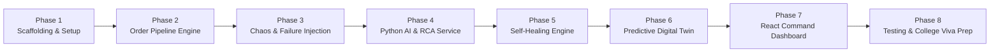

# Phased Development Roadmap & Evaluation Plan 🗺️
### OrderFlow Sentinel – Self-Healing AI for Order & API Failure Resolution

This roadmap divides the implementation of **OrderFlow Sentinel** into 8 structured phases. Each phase has concrete deliverables, verification tests, and measurable outcomes.

---

## 📅 Roadmap Overview

---

## 🎯 Phase-by-Phase Plan

### Phase 1: Project Scaffolding & Environment Setup
- **Objective:** Establish the clean monorepo / multi-service folder structure and ensure all 3 services (Frontend, Backend, AI) start cleanly.
- **Deliverables:**
  - Directory structure:
    - `/frontend` (React + Vite + Tailwind CSS + Recharts)
    - `/backend` (Node.js + Express + Mongoose + Socket.io)
    - `/ai_engine` (Python + FastAPI/Flask + Scikit-learn + Pandas)
  - Configuration files (`.env`, `package.json`, `requirements.txt`).
  - MongoDB connection verification script.
- **Verification Checklist:**
  - [ ] Node.js server starts on port 5000 and connects to MongoDB.
  - [ ] Python server starts on port 8000 and responds to `/health`.
  - [ ] React Vite dev server starts on port 5173.

---

### Phase 2: Telecom Order Processing Pipeline & Simulation Engine
- **Objective:** Implement the simulated 6-stage telecom broadband order journey.
- **Deliverables:**
  - Order state machine (`CRM` $\to$ `ORDER_MANAGEMENT` $\to$ `INVENTORY` $\to$ `PAYMENT` $\to$ `PROVISIONING` $\to$ `NOTIFICATION`).
  - Synthetic broadband order generator (generates customer profiles, fiber speed tiers, ONT equipment serials).
  - Stage execution simulation with realistic asynchronous delays (e.g., Inventory check takes 200–500ms, Provisioning takes 1200–2500ms).
  - MongoDB logging for each stage event in `orders` and `order_events`.
- **Verification Checklist:**
  - [ ] Ingesting a new order via `POST /api/orders` successfully flows through all 6 stages.
  - [ ] Total duration and stage timestamps are accurately persisted in MongoDB.

---

### Phase 3: Telemetry & Failure Injection Engine (Chaos Studio)
- **Objective:** Enable controllable failure injection to simulate all 3 target failure types.
- **Deliverables:**
  - Chaos controller endpoints (`POST /api/chaos/inject`):
    - **Failure 1 (API Errors):** Inject HTTP 500 on Provisioning, HTTP 504 on Payment.
    - **Failure 2 (Order Delays):** Introduce artificial queue latency exceeding stage SLAs.
    - **Failure 3 (Order Rejections):** Inject ONT inventory depletion or invalid customer credit.
  - Real-time event logger publishing failure events via Socket.io.
- **Verification Checklist:**
  - [ ] Triggering an injected 504 Gateway Timeout halts normal execution and marks the order status as `FAILED`.
  - [ ] Failure details are properly written to the `incident_logs` collection.

---

### Phase 4: Python AI Microservice (RCA & SLA Breach Predictor)
- **Objective:** Train and serve machine learning models for Root Cause Analysis and SLA Breach probability.
- **Deliverables:**
  - Synthetic training data generator script (`generate_dataset.py`) producing 5,000 realistic historical broadband order incidents.
  - Model training pipeline:
    - **Random Forest Classifier:** Classifies telemetry into root causes (`NETWORK_TIMEOUT`, `INVENTORY_SHORTAGE`, `PROVISIONING_CRASH`, etc.).
    - **Gradient Boosting Classifier:** Estimates SLA breach probability ($P \in [0.0, 1.0]$).
  - FastAPI / Flask endpoints:
    - `POST /predict/rca`: Accepts telemetry, returns predicted root cause, confidence score, and feature importance.
    - `POST /predict/sla-breach`: Accepts stage latency metrics, returns breach likelihood.
- **Verification Checklist:**
  - [ ] Trained models serialized as `.joblib` files.
  - [ ] Classification test accuracy achieves $\ge 90\%$ on synthetic test data.
  - [ ] Endpoint response time is under 25ms.

---

### Phase 5: Self-Healing Automation & Policy Engine
- **Objective:** Implement closed-loop auto-remediation for low-risk failures and human-in-the-loop escalation for high-risk failures.
- **Deliverables:**
  - Policy decision matrix in Node.js reading AI RCA outputs.
  - Automated remediation routines:
    - *Exponential Backoff Retry:* Automatically retries transient API 503/504 errors up to 3 times with progressive delays.
    - *Warehouse Failover:* Automatically switches inventory source from Depot A to Depot B.
    - *Fallback Notification:* Switches SMS to Email when SMS gateway fails.
  - Escalation mechanism: Flags high-risk incidents (physical line errors) for manual admin review.
  - Persistence of healing actions in `healing_actions` collection.
- **Verification Checklist:**
  - [ ] When a 504 error occurs, the self-healing engine automatically executes retries and transitions order from `FAILED` $\to$ `HEALING` $\to$ `COMPLETED`.
  - [ ] High-risk errors pause and wait for manual approval endpoint call.

---

### Phase 6: Predictive Digital Twin & What-If Simulation Sandbox
- **Objective:** Implement the innovative Digital Twin simulation feature.
- **Deliverables:**
  - Digital Twin State Synchronizer: Aggregates rolling metrics from MongoDB (`system_metrics`).
  - Monte Carlo What-If Simulation Engine in Python (`/simulate/twin`):
    - Ingests user-defined scenario parameters: load surge ($+X\%$), stage delay ($+Y\text{ms}$).
    - Simulates $N=500$ order iterations through the pipeline.
    - Projects queue spikes and predicted SLA breach rates.
  - Prescriptive Recommendation Evaluator:
    - Tests candidate actions (e.g., dynamically increase provisioning workers, shed low-tier tasks).
    - Returns the safest recommended operational strategy.
- **Verification Checklist:**
  - [ ] Running a "40% Order Surge" simulation returns a before-and-after SLA breach comparison graph and a concrete mitigation recommendation.

---

### Phase 7: Interactive Real-Time Command Center UI (React + Vite)
- **Objective:** Build a responsive, visual dashboard to monitor and demo the entire system.
- **Deliverables:**
  - **Live Pipeline Flow Visualizer:** 6-node graphical pipeline showing orders flowing through CRM $\to$ Notification in real time with status colors.
  - **Metrics Dashboard:** Recharts visualizations for:
    - Stage Latency Distribution (Bar Chart)
    - SLA Breach Probability Trend (Line Chart)
    - Incident Root Causes Breakdown (Pie / Donut Chart)
  - **Chaos Control Panel:** Sliders and buttons to inject failures live during demos.
  - **Digital Twin What-If Sandbox:** Sliders to adjust surge percentages and view predictive charts.
  - **Self-Healing Audit Feed:** Real-time log showing automatic resolution events.
- **Verification Checklist:**
  - [ ] Orders visibly progress across stages via WebSocket events without page refreshes.
  - [ ] Injected chaos immediately updates the UI with red alerts and triggers automatic self-healing badges.

---

### Phase 8: End-to-End Testing, College Viva Demo Script & Final Polish
- **Objective:** Final system validation, comprehensive testing, and preparation for college project defense.
- **Deliverables:**
  - End-to-end integration test script.
  - Single-command launcher (`npm run start:all`) using `concurrently`.
  - Academic project report summary, presentation slide template, and viva Q&A defense guide.
- **Verification Checklist:**
  - [ ] Zero unhandled errors across all 3 services during a 10-minute continuous simulation run.
  - [ ] Complete demo flow can be executed in under 5 minutes for external examiners.

---

## 🎓 College Viva Demonstration Script (Step-by-Step)

When presenting to professors or external evaluators, follow this winning 5-minute demonstration flow:

1. **Step 1: Normal Operation (The Baseline)**
   - Start the order generator. Show 10 broadband orders progressing smoothly through CRM $\to$ OMS $\to$ Inventory $\to$ Payment $\to$ Provisioning $\to$ Notification. Point out average latency in Recharts.
2. **Step 2: Injecting an API Failure (The Challenge)**
   - Click **"Inject Payment Gateway 504 Timeout"** in the Chaos panel.
   - Show the order turning RED (`FAILED`) at the Payment stage.
3. **Step 3: AI Diagnosis & Self-Healing (The Core Innovation)**
   - Point to the AI Incident card: show Random Forest diagnosis (`PAYMENT_GATEWAY_TIMEOUT`, Confidence: 94%, Risk Tier: `LOW`).
   - Watch the UI automatically transition the order to `HEALING` (Cyan badge).
   - Show the successful exponential backoff retry resolving the issue and the order reaching `COMPLETED`.
4. **Step 4: Predictive Digital Twin "What-If" Simulation (The Innovative Feature)**
   - Navigate to the **Digital Twin Sandbox**.
   - Explain: *"Before a major telecom marketing campaign, operators want to know if their system will hold up."*
   - Move the slider: Set **Order Volume Surge to +50%** and **Provisioning Latency to +800ms**.
   - Click **"Run Digital Twin Simulation"**.
   - Show the twin predicting a **34% SLA Breach Risk** and highlighting the **Provisioning stage** as the critical bottleneck.
   - Point out the AI Prescriptive Recommendation: *"Recommended Safest Action: Scale Provisioning concurrency pool from 4 to 8 workers (Expected SLA risk drops from 34% to 6%)"*.
