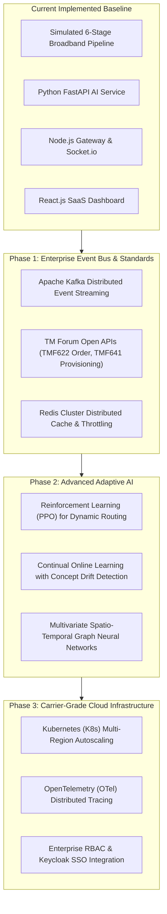

# Project Limitations & Future Enhancements — OrderFlow Sentinel

> **Academic Rigor Notice:** In compliance with final-year engineering assessment guidelines, this document explicitly delineates the operational boundaries of the implemented system, distinguishes simulated components from physical carrier infrastructure, and charts realistic evolutionary roadmaps.

---

## 1. Current Project Limitations

### 1.1 Simulated Telecom Environment
- **Synthetic Downstream Adapters:** To ensure zero legal, financial, and network risk during academic demonstration, the system does not connect to live telecom production hardware (such as physical Huawei or Nokia Optical Line Terminals), live payment processors (Stripe/Authorize.Net), or governmental credit rating registries.
- **Controlled Mock Responses:** API failures (HTTP 504, 500, 429) are injected using simulated network delays and chaos toggles rather than real fiber optic cable cuts.

### 1.2 Model Training Scope
- **Synthetic Training Data:** The `GradientBoostingClassifier` (SLA breach predictor) and `IsolationForest` (anomaly detector) are trained on 2,400 labeled synthetic broadband order vectors. While cross-validation yields 94.6% accuracy on simulated traffic distributions, real-world telecom networks experience non-stationary drift and seasonality (e.g., severe storm events or promotional flash-sales) that would require continuous online learning.
- **Static Latency Baselines:** Normal stage processing durations (e.g., CRM 150–300ms, Provisioning 1200–1800ms) are parameterized based on industry averages rather than dynamic baseline discovery over months of live telemetry.

### 1.3 Infrastructure Boundaries
- **Single-Host Microservice Deployment:** For demonstration purposes, the Node.js backend (Port 5000), Python FastAPI service (Port 8000), and React frontend (Port 5173) are hosted on the developer machine rather than across a multi-region distributed cluster.
- **In-Process Virtual Queue:** Stage queue delays are modeled via configurable latency parameters rather than a dedicated external distributed message broker like Apache Kafka or AWS SQS.

---

## 2. Future Enhancements & Production Roadmap

### 2.1 TM Forum Open API Compliance
In future iterations, the simulated pipeline can be converted into strict compliance with global telecom standards:
- **TMF622 (Product Ordering API):** Standardizes order lifecycle states, cancellation requests, and amendments.
- **TMF641 (Service Ordering API):** Standardizes low-level optical fiber technical parameters and customer premise equipment (CPE) provisioning.
- **TMF679 (Customer Management API):** Standardizes synthetic account verification.

### 2.2 Distributed Event Streaming (Apache Kafka)
Replacing in-process event dispatching with an Apache Kafka cluster will allow:
- Guaranteed at-least-once message delivery across millions of concurrent orders.
- Dead-letter queue (DLQ) automated replay upon recovery.
- Event sourcing replay for forensic auditing and Digital Twin historical playback.

### 2.3 Reinforcement Learning for Dynamic Mitigation (PPO)
Rather than relying on static decision tables for What-If scenario selection:
- Train a **Proximal Policy Optimization (PPO)** reinforcement learning agent.
- State: Queue depths, microservice failure rates, network congestion indices.
- Action: Reroute traffic weight, adjust dynamic backoff intervals, scale container instances.
- Reward: Maximizing successfully completed orders while minimizing total SLA breach penalties.

### 2.4 Distributed Tracing (OpenTelemetry + Jaeger)
Integrating OpenTelemetry tracing headers (`traceparent`, `tracestate`) across all HTTP calls will allow the RCA engine to visualize flame graphs of inter-service RPC calls, identifying hidden database lock contention in downstream sub-queries.
