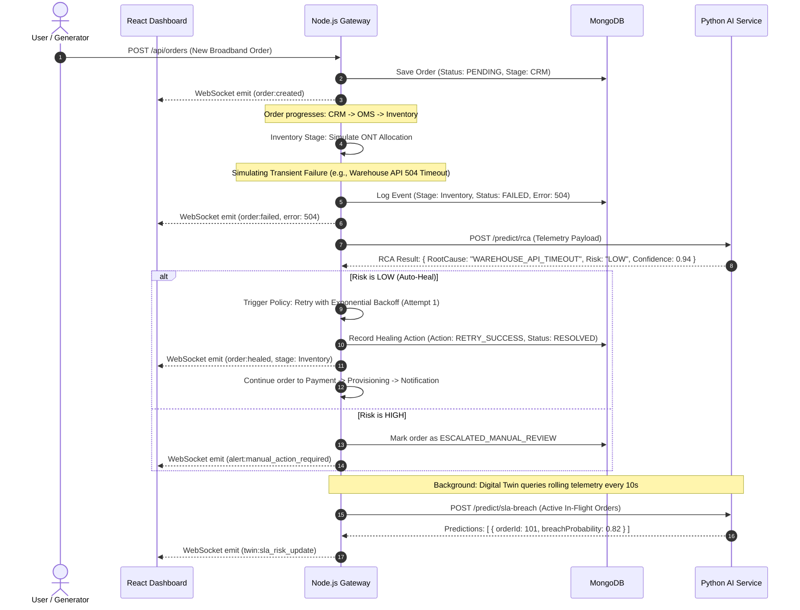

# System Architecture & Technical Design 🏛️
### OrderFlow Sentinel – Self-Healing AI for Order & API Failure Resolution

This document presents the architectural blueprint for **OrderFlow Sentinel**. It explains every layer, service communication mechanism, data lifecycle, and machine learning pipeline in clear, beginner-friendly language while maintaining rigorous engineering design.

---

## 1. High-Level Architecture Overview

The system is organized into a **Decoupled 3-Tier Architecture** with a specialized **AI/ML Microservice**:

```mermaid
flowchart TD
    subgraph ClientLayer ["1. Presentation Layer (React + Vite)"]
        UI["React Ops Dashboard\n(Vite + Tailwind CSS)"]
        Charts["Real-Time Charts\n(Recharts)"]
        SimControls["Chaos & Scenario\nControls"]
    end

    subgraph GatewayLayer ["2. Orchestration & Gateway Layer (Node.js + Express)"]
        API["Express REST API"]
        WS["WebSocket Server (Socket.io)"]
        StateMachine["Telecom Order State Machine\n(CRM -> Notification)"]
        FaultInjector["Failure Injection Engine\n(Chaos Simulator)"]
        Healer["Self-Healing Policy Executor"]
    end

    subgraph DataLayer ["3. Persistence Layer (MongoDB)"]
        DB[("MongoDB Database\nOrders, Telemetry, RCA, Twin Runs")]
    end

    subgraph AILayer ["4. Intelligence Layer (Python FastAPI / Flask)"]
        RCA["RCA Classifier\n(Random Forest)"]
        SLAPredictor["SLA Breach Predictor\n(Gradient Boosting)"]
        DigitalTwin["Predictive Digital Twin\n(Monte Carlo What-If Engine)"]
    end

    UI <-->|HTTP REST & WebSockets| API
    UI <-->|Live Stream| WS
    API <-->|Mongoose ODM| DB
    API <-->|Internal REST JSON (Port 8000)| AILayer
    StateMachine -->|State Events & Logs| DB
    Healer -->|Auto-Remediate / Compensate| StateMachine
    DigitalTwin -->|Scenario Recommendations| API
```

---

## 2. The 6 Independent Modules

To maintain clean code separation and simplify testing for college defense, the project is structured into six independent modules:

### Module 1: Telecom Order Journey Simulator
- **Purpose:** Models a real-world broadband provisioning lifecycle across 6 sequential stages:
  1. **CRM Stage:** Customer intake, address validation, broadband plan selection (e.g., *100 Mbps Fiber*, *1 Gbps Ultra*).
  2. **Order Management (OMS):** Order validation, order ID generation, state tracking.
  3. **Inventory Stage:** ONT (Optical Network Terminal) device reservation, optical splitter port allocation.
  4. **Payment Stage:** Invoice generation, upfront installation fee charge, billing tokenization.
  5. **Provisioning Stage:** Technical line activation, OLT (Optical Line Terminal) config, speed profile binding, RADIUS/DHCP IP assignment.
  6. **Notification Stage:** Customer dispatch notification (SMS/Email simulation), welcome kit issuance, order closure.
- **Implementation:** An asynchronous Node.js state machine transitioning orders through states: `PENDING` $\to$ `IN_PROGRESS` $\to$ `COMPLETED` (or `FAILED` / `HEALING` / `BREACHED`).

### Module 2: Telemetry & Failure Injection Engine (Chaos Simulator)
- **Purpose:** Emits live metrics and allows manual/automated chaos testing.
- **Telemetry Collected:** Timestamp, stage latency (ms), HTTP response codes, queue depth, CPU load simulation, retry count.
- **Controllable Failure Injections:**
  - *API Errors:* 500 Internal Error, 504 Gateway Timeout, 400 Bad Request.
  - *Order Delays:* Artificial stage sleep (e.g., 4000ms delay in Provisioning).
  - *Order Rejections:* "ONT Out of Stock", "Port Allocation Exhausted", "Card Expired".

### Module 3: AI Anomaly Detection & RCA Microservice (Python)
- **Purpose:** Runs machine learning models over incoming order telemetry to determine:
  1. Is this order anomalous? (Anomaly Detection)
  2. What is the root cause? (Root Cause Analysis - RCA classification)
  3. What is the predicted probability of an SLA breach? (SLA Breach Prediction)
- **Implementation:** Python microservice using FastAPI/Flask with Scikit-learn models pre-trained on historical broadband order event logs.

### Module 4: Self-Healing & Policy Execution Engine
- **Purpose:** Resolves failures autonomously according to a Risk-Tiered Matrix:
  - **Low-Risk Failures (Auto-Heal):** 
    - *Payment 504 Timeout* $\to$ Trigger automated idempotent retry with exponential backoff.
    - *Inventory Warehouse A Stockout* $\to$ Dynamic failover to secondary regional warehouse B.
    - *Notification SMS Gateway Down* $\to$ Reroute message via fallback email channel.
  - **High-Risk Failures (Human-in-the-Loop):**
    - Line provisioning physical port mismatch or repeated credit card decline triggers an escalation ticket for human approval on the React UI.

### Module 5: Predictive Digital Twin & What-If Simulation Sandbox
- **Purpose:** The innovative core of the project. A software replica that runs in parallel with the live system.
- **Capabilities:**
  - Ingests rolling 15-minute operational metrics (current order arrival rate, stage queue lengths, average latency per stage).
  - Calculates the forward SLA breach risk for all in-flight orders.
  - **"What-If" Simulation:** Evaluates user-defined operational stress tests:
    - *Scenario A:* "What if order intake increases by 50% due to a flash sale?"
    - *Scenario B:* "What if the Provisioning microservice experiences 2x latency?"
  - **Prescriptive Recommendation:** Compares the simulated outcomes and outputs the safest operational mitigation (e.g., *"Throttle non-priority batch orders by 20%"* or *"Pre-allocate 15 reserve ONT units"*).

### Module 6: Interactive Command Center UI (React + Vite)
- **Purpose:** Central glass-box monitoring interface.
- **Key Views:**
  - **Live Pipeline Flow:** Animated multi-stage diagram showing orders moving through CRM $\to$ Notification with visual state badges (Green = Healthy, Yellow = Delayed, Red = Failed, Cyan = Healing).
  - **Failure & RCA Inspector:** Shows AI diagnosis, confidence score, and root cause breakdown.
  - **Digital Twin Sandbox:** Slider controls for what-if scenarios with before-and-after SLA breach comparison charts.
  - **Self-Healing Audit Trail:** Live table of all automated and manual resolutions.

---

## 3. Communication Protocols: React, Node.js, MongoDB & Python

Beginners often wonder: *How do 4 different technologies work together seamlessly?*  
Here is the step-by-step communication mechanism:

```
+--------------------------------------------------------------------------------+
|                             INTER-SERVICE FLOW                                 |
+--------------------------------------------------------------------------------+

  [React Frontend] (Port 5173)
         |
         |  1. HTTP Requests (Fetch orders, trigger chaos injection, run twin sandbox)
         |  2. WebSocket / Socket.io (Receives live order events, alerts, metrics)
         v
  [Node.js Backend] (Port 5000)
         |
         +-----> [MongoDB Database] (Port 27017)
         |         Uses Mongoose ODM to read/write:
         |         - Orders collection
         |         - Incident logs
         |         - Simulation results
         |
         +-----> [Python AI Microservice] (Port 8000)
                   Node.js sends JSON via HTTP POST to Python endpoints:
                   - POST /predict/rca         --> returns root cause & risk score
                   - POST /predict/sla-breach  --> returns breach probability
                   - POST /simulate/twin       --> runs What-If Monte Carlo simulation
```

### Why this communication pattern?
1. **Node.js as the Orchestrator:** Node.js excels at asynchronous I/O, websockets, and coordinating high-concurrency order events.
2. **Python as the Math/AI Engine:** Python has the mature data science ecosystem (Scikit-Learn, Pandas, NumPy). Separating it into an HTTP microservice means the AI models can be updated and trained without stopping the Node.js server.
3. **WebSockets for Instant UI Feedback:** Instead of the React dashboard polling every second, Node.js pushes updates to React the moment an order changes stage or a self-healing action executes.

---

## 4. Complete End-to-End Data Flow

Let's trace a single broadband order from creation through a failure and self-healing recovery:



---

## 5. Machine Learning & Statistical Algorithms

OrderFlow Sentinel uses targeted, interpretable, and computationally efficient machine learning algorithms ideal for college presentations and real-world operations:

### A. Failure Classification & Root Cause Analysis (RCA)
- **Algorithm:** **Random Forest Classifier** (with Decision Tree fallback for rule explainability).
- **Why?** Telecom telemetry features (HTTP status codes, latency, payload size, retry count, time of day) have non-linear relationships. Random Forest provides high accuracy, handles categorical and numeric features well, and outputs **Feature Importance** (explainable AI for college viva).
- **Features Ingested:**
  - `stage_id` (CRM, OMS, Inventory, Payment, Provisioning, Notification)
  - `latency_ms`
  - `http_status` (200, 400, 404, 500, 503, 504)
  - `retry_count`
  - `payload_error_keyword_encoded` (e.g., "timeout", "out_of_stock", "auth_failed")
  - `concurrent_orders_in_stage`
- **Output:** Predicted Root Cause class (e.g., `TRANSIENT_NETWORK_TIMEOUT`, `INVENTORY_DEPLETION`, `GATEWAY_OVERLOAD`, `AUTHENTICATION_REJECTION`) with confidence probability $P \in [0.0, 1.0]$.

### B. SLA Breach Prediction
- **Algorithm:** **Gradient Boosting Classifier / Regressor** (Histogram-based Gradient Boosting or Scikit-Learn `GradientBoostingClassifier`).
- **Why?** It models early warnings of delays. If an order spends 2000ms in Inventory when the historical mean is 300ms, the probability of exceeding the total 5-minute end-to-end SLA surges.
- **Target:** Binary flag ($1$ if total order time $> \text{SLA Threshold}$, else $0$) or continuous regression predicting remaining completion time.

### C. Predictive Digital Twin (What-If Simulation Engine)
- **Algorithm:** **Monte Carlo Discrete-Event Simulation & Queueing Theory ($M/M/c$ approximation)**.
- **How it works:**
  1. The Twin maintains a statistical snapshot of each stage: $\mu_{stage}$ (mean processing service rate) and $\lambda_{stage}$ (order arrival rate).
  2. When a user runs a "What-If" scenario (e.g., *"Increase order load by +40%"*), the Twin runs $N=500$ stochastic iterations drawing latency values from the fitted log-normal distribution of each stage.
  3. It tallies simulated queue backlogs and estimates the percentage of orders that will breach SLA under that scenario.
  4. It tests 3 mitigation strategies (e.g., throttle rate, scale worker concurrency, skip non-essential notifications) and highlights the one with the lowest expected risk score.

---

## 6. Self-Healing Policy & Risk Matrix

To prevent unsafe automated modifications, resolutions are strictly categorized:

| Incident Type | Root Cause | Risk Level | Automated Healing Action (Zero-Touch) | Human Approval Needed? |
| :--- | :--- | :--- | :--- | :--- |
| **Payment 504 Gateway Timeout** | Network glitch at payment processor | **LOW** | Idempotent exponential backoff retry (Max 3 attempts) | ❌ No (Automatic) |
| **Notification SMS Failure** | SMS Provider API down | **LOW** | Fallback to secondary Email notification channel | ❌ No (Automatic) |
| **Inventory ONT Unavailable (Local)** | Local depot stock depleted | **LOW** | Auto-reroute reservation to Regional Backup Warehouse | ❌ No (Automatic) |
| **Provisioning Port Mismatch** | Physical fiber splitter config error | **HIGH** | Mark order for Line Engineer inspection; pause pipeline | ✅ Yes (Manual review) |
| **Payment Card Hard Decline** | Insufficient funds / Fraud block | **HIGH** | Trigger customer notification link to update card info | ✅ Yes (Manual review) |
| **Repeated 500 Provisioning Crash** | Database lock in telecom switch | **HIGH** | Circuit Breaker tripped; queue orders in paused state | ✅ Yes (Manual review) |

---

## 7. Potential Technical Difficulties & Mitigation

| Challenge | Risk | Mitigation Strategy |
| :--- | :--- | :--- |
| **Cross-Language Latency (Node $\leftrightarrow$ Python)** | Network overhead slow down simulated pipeline | Use persistent keep-alive HTTP connections and lightweight JSON payloads. Fast endpoints respond in $<15\text{ms}$. |
| **Generating Realistic Synthetic Data** | ML model needs training data before the system has run for days | We include a Python synthetic dataset generator script (`generate_dataset.py`) that models real telecom broadband failure distributions and pre-trains model `.joblib` files. |
| **Digital Twin Performance in Browser** | Running simulations might freeze the React UI | Node.js / Python computes the simulation iterations asynchronously and sends only the aggregated summary percentiles to React. |
| **Avoiding Infinite Healing Loops** | Retry logic repeatedly calling a dead service | Strict `max_retries = 3` cap with exponential backoff plus a **Circuit Breaker** state flag per service stage. |
| **Multi-Service Dev Setup for College Evaluation** | Reviewers struggling to launch multiple terminals | Provide a single command startup script (`npm run dev:all` or `concurrently`) that starts React, Node.js, and Python simultaneously. |
