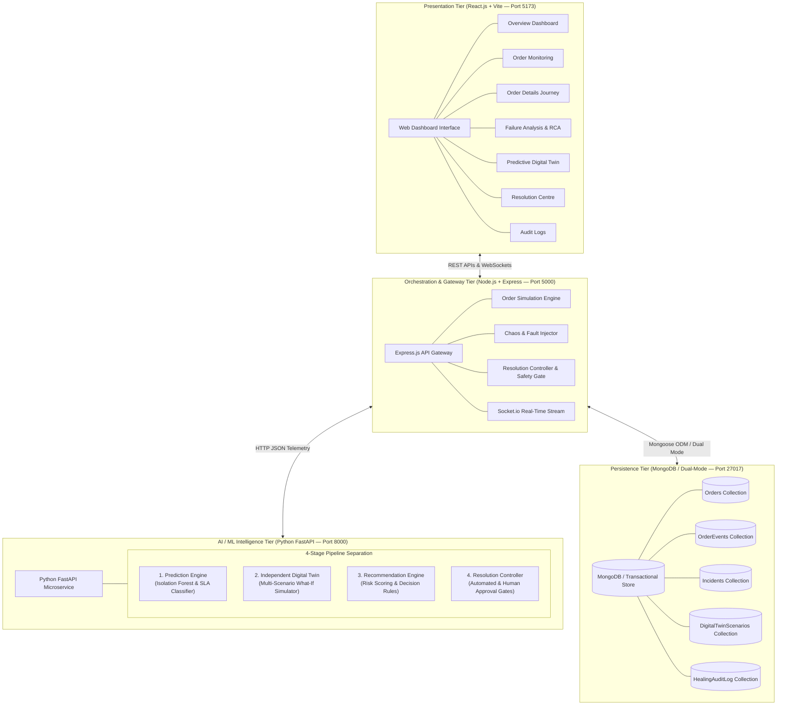
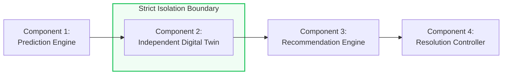
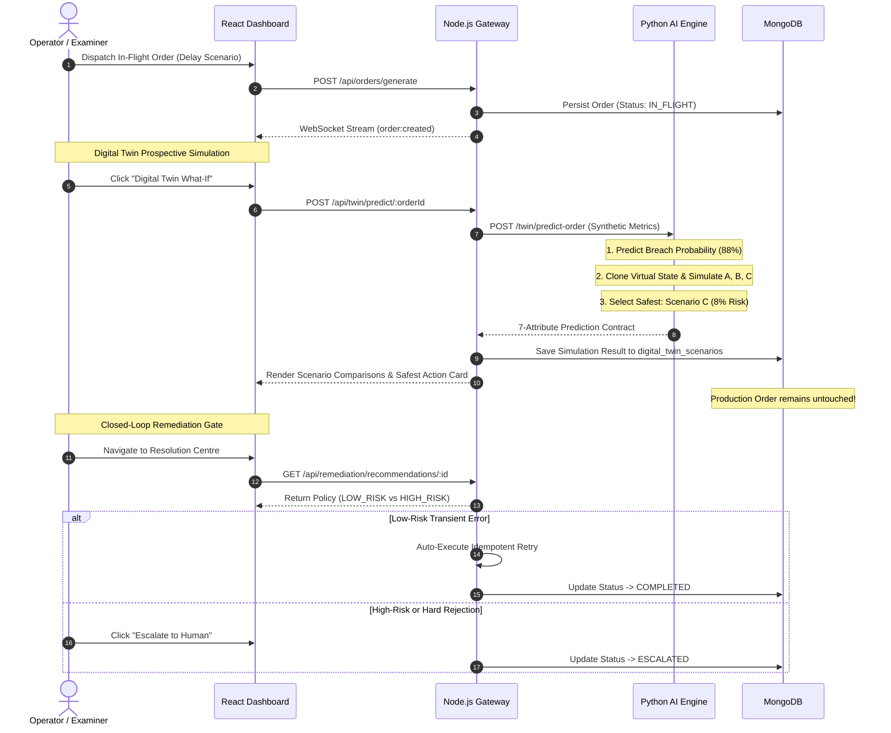

# System Architecture Documentation — OrderFlow Sentinel

> **Project Title:** OrderFlow Sentinel – Self-Healing AI for Order & API Failure Resolution with Predictive Digital Twin  
> **Domain:** Telecom Order-to-Activation, Autonomous AIOps, Self-Healing Systems, Machine Learning  
> **Target Evaluation:** Final-Year College Engineering Capstone Project  

---

## 1. High-Level Architectural Overview

**OrderFlow Sentinel** is built as an enterprise-grade multi-tier microservice architecture. It provides continuous surveillance, failure detection, automated root-cause analysis, closed-loop self-healing, and prospective "What-If" simulation across a simulated telecom broadband order lifecycle:

$$\text{CRM} \longrightarrow \text{OMS} \longrightarrow \text{Inventory} \longrightarrow \text{Payment} \longrightarrow \text{Provisioning} \longrightarrow \text{Notification}$$



---

## 2. Decoupled 4-Component Intelligence Pipeline

To guarantee system stability, safety, and academic clarity, the AI operations workflow is strictly partitioned into **four independent components**:



### Component 1: Prediction Engine (SLA Breach & Anomaly Identification)
- **Role:** Observes active orders and calculates failure risk before the pipeline terminates.
- **Inputs:** Current stage, cumulative elapsed time, recent API latency, active queue wait time, service health score, retry count.
- **Models:**
  - *Unsupervised Latency Anomaly Detector:* Scikit-Learn Isolation Forest scores latency spikes against historical baselines.
  - *SLA Breach Classifier:* Evaluates probability ($0.0$ to $1.0$) of exceeding the 3500ms max SLA threshold.
- **Output:** Risk score and breach probability.

### Component 2: Independent Digital Twin (Virtual Multi-Scenario Simulation)
- **Role:** An independent simulation module that models prospective futures without modifying production systems.
- **Real Metrics Grounding:** Powered by actual synthetic order metrics, downstream service response times, queue buffer delays, and configured SLA targets.
- **Decoupled Sandbox Guarantee:** Operates strictly on a read-only virtual state clone. **It never modifies actual orders or executes real recovery actions.**
- **Concurrent Scenario Simulation:**
  - *Scenario A:* Continue using the current degraded service route.
  - *Scenario B:* Pause for a short 500ms exponential backoff cooldown and retry.
  - *Scenario C:* Dynamically route through a verified healthy standby backup gateway (`olt-backup-02`).

### Component 3: Recommendation Engine (Policy & Tradeoff Scoring)
- **Role:** Evaluates prospective outcomes from the Digital Twin and formulates actionable guidance.
- **Decision Criteria:** Minimizes residual SLA breach risk and total completion duration while respecting operational safety tiers.
- **Prescription:** Recommends the safest feasible scenario with human-readable reasoning and supporting evidence.

### Component 4: Resolution Controller (Safety Policy & Execution)
- **Role:** Enforces system safety guardrails before any recovery action is dispatched.
- **Three-Tier Safety Policy:**
  1. **Low-Risk Actions (Autonomous Execution):** Transient 504 timeouts, 429 rate-limit backoff, and synthetic token refresh are eligible for automated healing using strict idempotency keys (`IDEM-...`).
  2. **High-Risk Actions (Operator Approval Required):** Infrastructure route switching or customer data modifications require explicit human operator confirmation in the Resolution Centre.
  3. **Hard Business Rejections (Never Overridden):** Hard validation failures (e.g. addresses outside fiber coverage boundaries or credit denials) are strictly blocked from automated override and must be escalated to human operations.

---

## 3. Mandatory Prediction Payload Schema

Every predictive analysis generated by the Digital Twin complies with a standardized 7-attribute contract:

```json
{
  "orderNumber": "ORD-104921",
  "riskScore": 78,
  "predictedSlaBreachProbability": 0.88,
  "expectedCompletionTimeMs": 2850,
  "simulationScenarios": [
    {
      "scenarioKey": "SCENARIO_A",
      "name": "Continue Current Gateway Route",
      "estimatedProcessingTimeMs": 2400,
      "predictedSlaBreachRisk": 0.88,
      "expectedTotalDurationMs": 3850,
      "isSafest": false
    },
    {
      "scenarioKey": "SCENARIO_B",
      "name": "Retry After 500ms Backoff Cooldown",
      "estimatedProcessingTimeMs": 1400,
      "predictedSlaBreachRisk": 0.45,
      "expectedTotalDurationMs": 2850,
      "isSafest": false
    },
    {
      "scenarioKey": "SCENARIO_C",
      "name": "Route via Standby Backup Gateway",
      "estimatedProcessingTimeMs": 420,
      "predictedSlaBreachRisk": 0.08,
      "expectedTotalDurationMs": 1870,
      "isSafest": true
    }
  ],
  "recommendedAction": "ROUTE_BACKUP_GATEWAY",
  "supportingEvidence": {
    "currentApiLatencyMs": 2500,
    "queueDelayMs": 280,
    "serviceHealthScore": 0.72,
    "observedAnomaly": true,
    "isolationForestScore": 0.68,
    "precedingStagesCompleted": ["CRM", "OMS", "INVENTORY", "PAYMENT"]
  }
}
```

---

## 4. End-to-End Operational Lifecycle



---

## 5. Architectural Guardrails & Safety Policies

1. **Strict Simulation Decoupling:** The Digital Twin operates purely in an isolated sandbox. It clones the order's state in memory. Simulation reads production data but **never mutates production orders or triggers recovery**.
2. **Idempotency Key Enforcement:** Every remediation request must submit an RFC-compliant idempotency key (`IDEM-{orderNumber}-{stage}-{attempt}`). Repeating an execution returns the previously completed record rather than repeating side effects.
3. **Hard Rejection Escalation Fence:** When an order is rejected for validation (e.g. unserviceable fiber address), the safety engine blocks automatic retry, classifies it as `HIGH_RISK`, and forces human operator dispatch.
4. **Circuit Breaker Ceiling:** Retries are strictly capped at 3 attempts per stage to eliminate infinite looping.
5. **No Secret Leaks:** Scrubbing filters ensure API keys, database credentials, and internal connection strings are never exposed in REST responses or frontend state.
